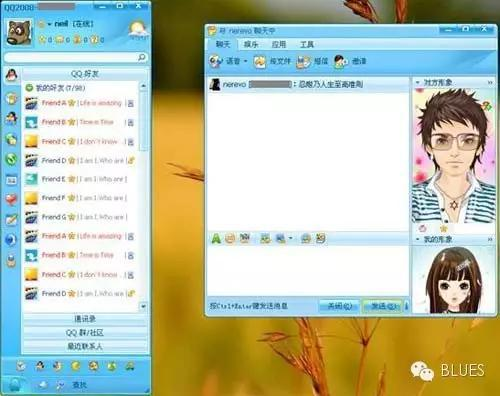
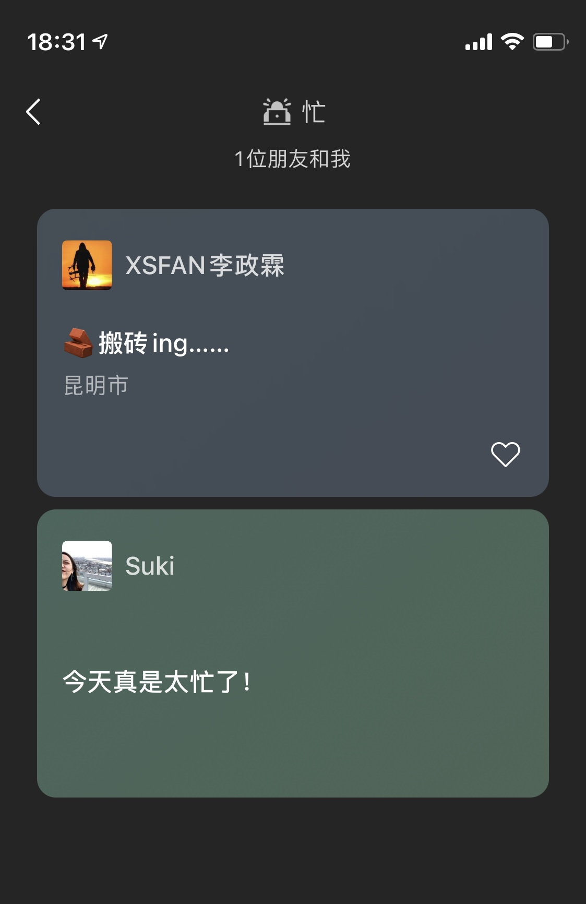
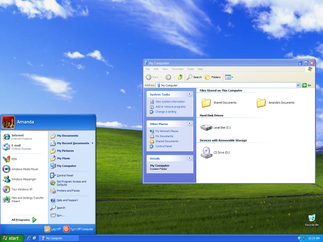

# 博物馆版本浏览清单

采集日期：2026-11-17。3个产品系列，37个精选版本，31个有效本地图片文件；另附微信官网504条分平台版本日期索引。

图片均为待审核参考素材，不能由“已收录”推定“可以公开转载”。未配图的版本明确留空，不用新Logo冒充旧界面。

## 腾讯 QQ

| 版本 | 日期或展览年份 | 简介 | 参考图片 |
| --- | --- | --- | --- |
| OICQ 1999 | 1999-02-10 | OICQ 起点；展示早期在线联系人的沟通方式。 | 待补图 |
| QQ 2000 | 2000（版本年号，首发日待核实） | 早期年号版，保留了简洁的联系人面板。 | 待补图 |
| QQ 2003 | 2003（版本年号，首发日待核实） | 以聊天场景、截图等功能丰富沟通体验。 | [图1](assets/reference-only/qq-2003-screenshot.jpg) |
| QQ 2004 | 2004（版本年号，首发日待核实） | 网络硬盘与远程协助扩展桌面沟通用途。 | [图1](assets/reference-only/qq-2004-screenshot.jpg) |
| QQ 2005 | 2005（版本年号，首发日待核实） | QQ 宠物与空间相关内容成为这一时期的记忆。 | [图1](assets/reference-only/qq-2005-screenshot.jpg) |
| QQ 2007 | 2007（版本年号，首发日待核实） | 窗口抖动与离线文件成为这一时期的沟通记忆。 | [图1](assets/reference-only/qq-2007-screenshot.jpg) |
| QQ 2008 | 2008（版本年号，首发日待核实） | 年号版桌面 QQ，可观察联系人分组与群入口。 | [图1](assets/reference-only/qq-2008-screenshot.jpg) |
| QQ 2009 | 2009（版本年号，首发日待核实） | 通过消息盒子、群友动态等内容组织沟通。 | [图1](assets/reference-only/qq-2009-screenshot.jpg) |
| QQ 2010 | 2010（版本年号，首发日待核实） | 皮肤与视频等体验继续演进的桌面年号版。 | [图1](assets/reference-only/qq-2010-screenshot.jpg) |
| QQ 2011 | 2011（版本年号，首发日待核实） | 以应用盒子、皮肤编辑等入口丰富桌面体验。 | [图1](assets/reference-only/qq-2011-screenshot.jpg) |
| QQ 2012 | 2012（版本年号，首发日待核实） | 可合并、置顶的会话窗口体现聊天界面的变化。 | [图1](assets/reference-only/qq-2012-screenshot.jpg) |
| QQ 2013 | 2013（版本年号，首发日待核实） | 这一时期的资料卡与群视频提供新的展示空间。 | 待补图 |

通用标识：[查看图片](assets/reference-only/qq-brand-logo.svg)。此图不代表任何旧版本的历史标识。

## 微信

| 版本 | 日期或展览年份 | 简介 | 参考图片 |
| --- | --- | --- | --- |
| 1.0(测试版) | 2011-01-21 | 微信最初的 iOS 测试版，保留移动沟通起点。 | 待补图 |
| 2.0 | 2011-05-10 | 语音对讲成为移动聊天的重要方式。 | 待补图 |
| 2.5 | 2011-08-03 | 通过附近的人扩展联系范围。 | 待补图 |
| 3.0 | 2011-10-01 | 摇一摇与漂流瓶扩展社交发现方式。 | 待补图 |
| 4.0 | 2012-04-19 | 朋友圈记录与分享生活。 | 待补图 |
| 4.2 | 2012-07-19 | 视频通话和网页版拓展沟通场景。 | 待补图 |
| 5.0 | 2013-08-05 | 表情、扫一扫与支付等入口扩展产品用途。 | 待补图 |
| 6.0 | 2014-09-30 | 小视频和卡包进入日常交流与使用场景。 | 待补图 |
| 7.0.0 | 2018-12-21 | 界面更新，同时推出时刻视频等功能。 | 待补图 |
| 8.0.0 | 2021-01-21 | 动态表情与个人状态丰富表达方式。 | [图1](assets/reference-only/wechat-ios-8-0-screen-2.jpg)、[图2](assets/reference-only/wechat-ios-8-0-screen-3.jpg) |

通用标识：[查看图片](assets/reference-only/wechat-brand-logo.png)。此图不代表任何旧版本的历史标识。

## Microsoft Windows

| 版本 | 日期或展览年份 | 简介 | 参考图片 |
| --- | --- | --- | --- |
| 1.0 系列 | 1985-11-20 | 平铺窗口与鼠标操作构成早期 Windows 图形环境。 | [图1](assets/reference-only/windows-1-0-screenshot.png) |
| 2.0 系列 | 1987-12-09 | 重叠窗口使桌面操作方式继续演进。 | [图1](assets/reference-only/windows-2-0-screenshot.png) |
| 3.0 | 1990-05-22 | 程序管理器与图标式操作成为界面记忆。 | [图1](assets/reference-only/windows-3-0-screenshot.png) |
| 3.1 | 1992-04-06 | TrueType 字体与多媒体能力丰富桌面体验。 | [图1](assets/reference-only/windows-3-1-screenshot.png) |
| 95 | 1995-08-24 | 开始菜单与任务栏构成经典桌面布局。 | [图1](assets/reference-only/windows-95-screenshot.png) |
| 98 | 1998-06-25 | 面向家庭电脑，延续并扩展 Windows 95 的桌面风格。 | [图1](assets/reference-only/windows-98-screenshot.png) |
| 2000 | 2000-02-17 | NT 系列面向工作环境的一次重要迭代。 | [图1](assets/reference-only/windows-2000-screenshot.png) |
| Me | 2000-09-14 | 面向家庭的 Windows 9x 系列末期版本。 | [图1](assets/reference-only/windows-me-screenshot.png) |
| XP | 2001-10-25 | Luna 视觉样式与开始菜单构成一代桌面记忆。 | [图1](assets/reference-only/windows-xp-screenshot.png) |
| Vista | 2007-01-30 | Aero 视觉风格与用户账户控制进入公众视野。 | [图1](assets/reference-only/windows-vista-screenshot.png) |
| 7 | 2009-10-22 | 改进任务栏与窗口管理，延续 Aero 桌面风格。 | [图1](assets/reference-only/windows-7-screenshot.png) |
| 8 | 2012-10-26 | 开始屏幕与触控导向界面改变桌面入口。 | [图1](assets/reference-only/windows-8-screenshot.png) |
| 8.1 | 2013-10-17 | 在 Windows 8 基础上继续调整开始与桌面体验。 | [图1](assets/reference-only/windows-8-1-screenshot.png) |
| 10 | 2015-07-29 | 开始菜单回归，并持续迭代桌面使用体验。 | [图1](assets/reference-only/windows-10-screenshot.png) |
| 11 | 2021-10-05 | 居中任务栏与新的窗口布局体现新一代桌面设计。 | [图1](assets/reference-only/windows-11-screenshot.png) |

## 图片样例

仅供核对素材内容，完整来源和许可字段见 assets.json。

### QQ 2008参考界面

QQ 2008联系人及聊天窗口，画面标题可见QQ2008。

### 微信8.0状态界面

微信8.0状态界面参考图；含来源文章中的昵称和头像，公开前需审核隐私与版权。

### Windows XP参考桌面

Windows XP信息框截图；语言和补丁版本以源图说明为准。

## 待完善项

- 没有精确首发日的QQ年号版本，继续查官方发布存档。
- 缺图版本补充来源、版本及补丁号能够对应的真实界面截图。
- 对所有拟上线图片逐张完成版权、署名、商标与隐私检查。
- 具体下载失败、原站重复版本标签等情况，见 collection-report.json。
